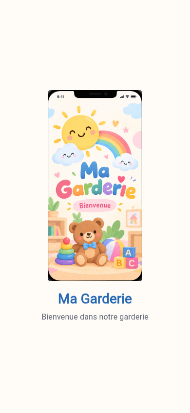
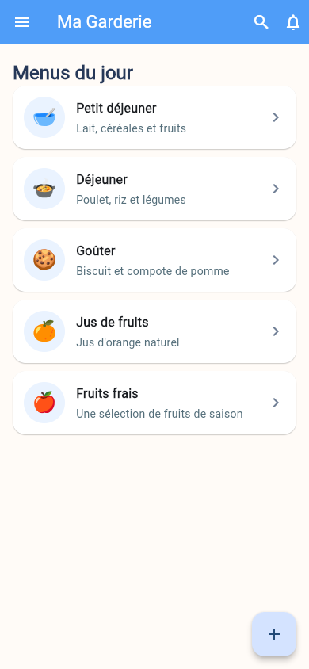
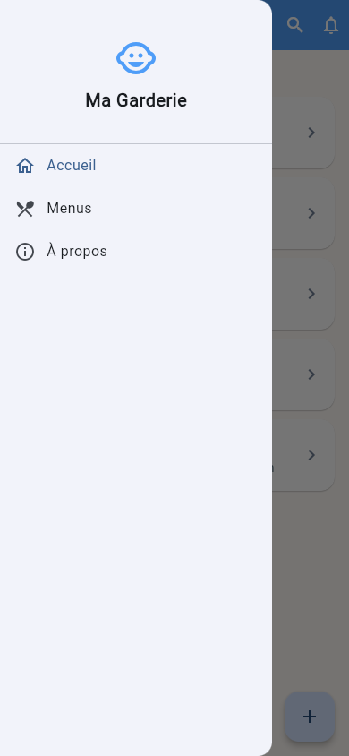
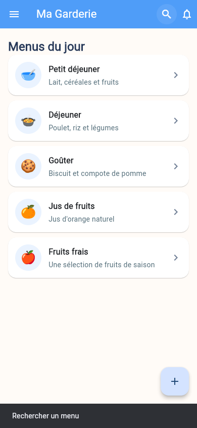

# Ma Garderie

Application Flutter de garderie présentant les menus du jour. Les données sont
déclarées localement dans le code : aucun serveur, base de données ou compte
n'est nécessaire.

## Technologies

- Flutter et Dart
- Git et GitHub

## Installation et lancement

Prérequis : Flutter installé et configuré (`flutter doctor`). Pour Android,
installer Android Studio et démarrer un émulateur ou connecter un appareil.

```bash
git clone https://github.com/aliabidi131/garderie-mobile-g2.git
cd garderie-mobile-g2
flutter pub get
flutter run -d chrome
```

Pour lancer l'application sur un appareil ou un émulateur :

```bash
flutter devices
flutter run -d <identifiant-de-l-appareil>
```

## Captures d'écran

### Splash Screen



### Page principale et menus du jour



### Drawer ouvert



### Message après une interaction



## Vérification

```bash
flutter analyze
flutter test
```

Les étapes de réalisation et les commandes Git détaillées sont dans
[EXPLICATION.md](EXPLICATION.md).
